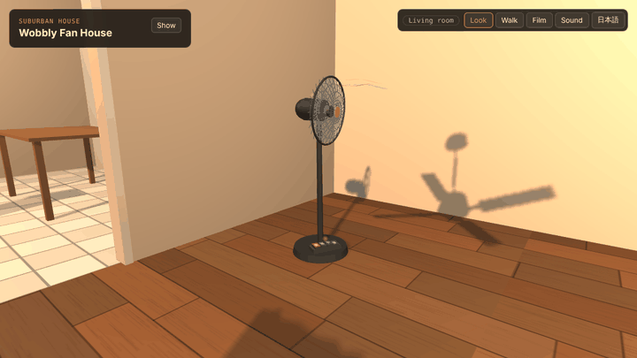
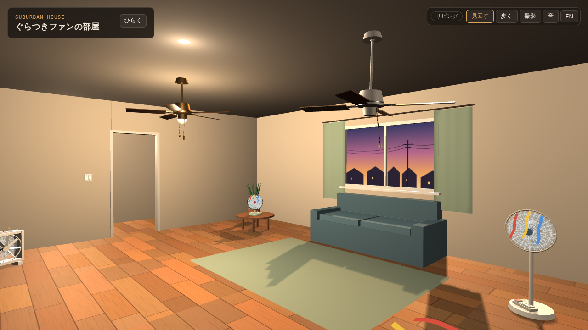
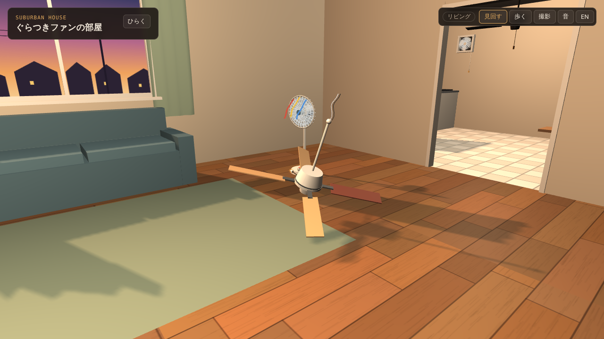
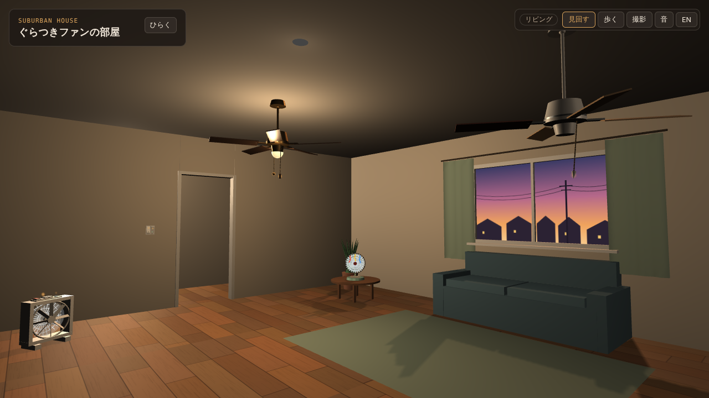
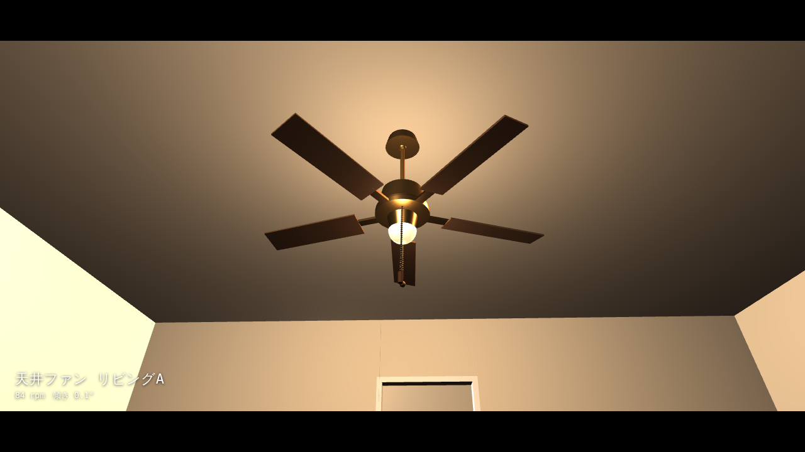
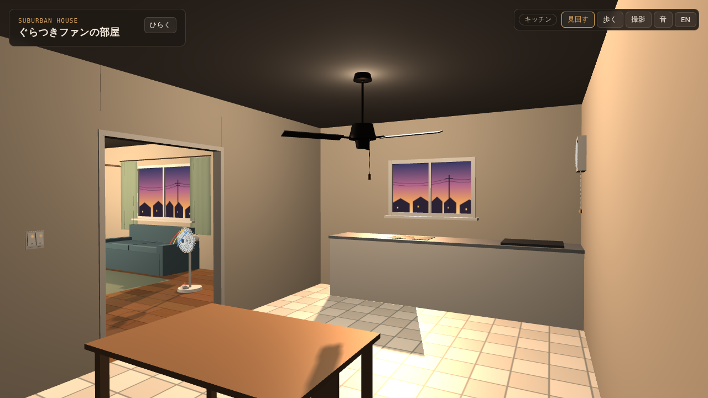
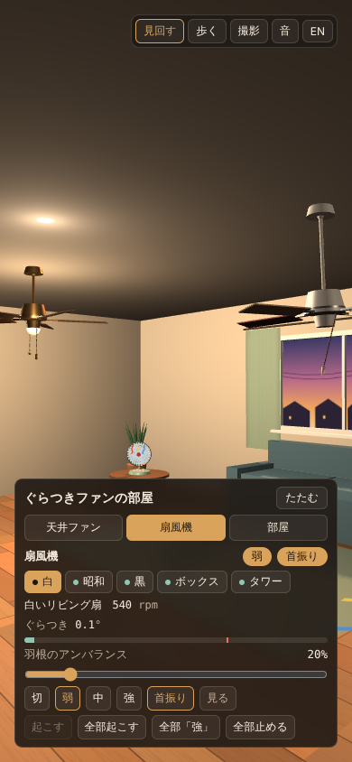

<h1 align="center">ぐらつきファンの部屋</h1>

<p align="center"><a href="README.md">English</a> | <b>日本語</b></p>

<p align="center">
  <b>天井ファンと扇風機だらけの家。ぐらつき、倒れ、天井から落ちる。<br>
  ひもを引き、スイッチを入れ、羽根のアンバランスを上げて、どこまで耐えるか試せます。</b>
</p>

<p align="center">
  <a href="https://futurecortexlabs.github.io/FCTX_Wobbly_Fan_House/"><b>▶ デモを開く</b></a>
  &nbsp;·&nbsp;
  <a href="#物理の話">物理の話</a>
  &nbsp;·&nbsp;
  <a href="#既知の限界">既知の限界</a>
</p>

<p align="center">
  
</p>

<p align="center">
  <sub>
  黒い扇風機は羽根が1枚曲がっています。アンバランスを上げるとぐらつきが転倒ラインを超え、揺れが大きくなって臨界角を超えたところで倒れます。倒れる先は決め打ちではありません。倒れる方向に家具・壁・ほかの扇風機があるかを調べて、ここではドア枠に当たって寄りかかっています。ヘッドレスブラウザで録画しました。
  </sub>
</p>

---

## これは何か

Roblox で、家の中を歩き回って変な揺れ方をする天井ファンを見て回る動画があります。それをヒントに作った、ブラウザで動く小さな3Dの家です。家・ファン・テクスチャ・音はすべてコードで生成しています。Roblox の素材は使っておらず、Roblox とは関係ありません。

**HTML 1ファイル**で完結しています。Three.js は CDN から読み込み、ビルドは不要です。

| 操作 | 起きること |
|:--|:--|
| **天井ファンのひもを引く** | 速度が 強→中→弱→切 の順に切り替わる。実物の引きひもと同じ順番。ひもは引いたときにも、本体が揺れたときにも振れる |
| **壁スイッチを押す** | 各部屋に2連のワイドスイッチがあり、片方がファン、もう片方が照明。切のときは小さな緑の位置表示ランプが光る（ほたるスイッチ） |
| **羽根のアンバランスを上げる** | ファンがぐらつきはじめる。一番揺れるのは最高速ではなく、そのファン自身の共振速度の近く |
| **上げすぎる** | 天井ファンは天井から外れ、配線をぶら下げたまま床に落ちる。扇風機は揺れがどんどん大きくなって倒れ、転倒OFFスイッチでモーターが止まる |
| **照明を消す** | 部屋が暗くなり、窓の外の夕焼け、照明付きファンのランプ、スイッチのランプだけが残る |
| **歩く・撮影する** | 部屋から部屋へ歩いて回れる。撮影モードではカメラが各ファンを順番に映し、名前と回転数を字幕で出す（録画用） |

画面は右上のボタンで**日本語と英語**を切り替えられます。扇風機のキーに印刷された「切・弱・中・強」は家電の一部なので、英語表示でも日本語のままです。

<table>
<tr>
<td width="50%"></td>
<td width="50%"></td>
</tr>
<tr>
<td></td>
<td></td>
</tr>
<tr>
<td></td>
<td align="center"></td>
</tr>
</table>

---

## 動かす

- **オンライン**：[futurecortexlabs.github.io/FCTX_Wobbly_Fan_House](https://futurecortexlabs.github.io/FCTX_Wobbly_Fan_House/)
- **オフライン**：リポジトリをクローンして `index.html` をブラウザで開くだけです。初回は jsDelivr から Three.js を読み込むためネット接続が必要です。
- **言語**：URL に `?lang=ja` か `?lang=en` を付けるか、右上のボタンで切り替えます。選んだ言語はブラウザに記憶されます。

WebGL が動く今のブラウザ（Chrome、Edge、Safari、Firefox）なら、パソコンでもスマホでも動きます。

| モード | パソコン | スマホ |
|:--|:--|:--|
| **見回す** | ドラッグで回転、ホイールでズーム | ドラッグで回転、ピンチでズーム |
| **歩く** | WASD か矢印キー、Shift で走る、ドラッグで向きを変える | 左下のスティック、ドラッグで向きを変える |
| **撮影** | クリックか Esc で終了 | タップで終了 |

操作できる場所には光る点が付いています。部屋の欄の「目印」で消せます。

---

## 家の中身

| 部屋 | 天井ファン | ほかのファン |
|:--|:--|:--|
| **リビング** | **リビングA**：真鍮、5枚羽根、照明付き<br>**リビングB**：白、4枚羽根。1枚だけ色違いの重い交換羽根 | **白**いリビング扇・ちゃぶ台の上の**昭和**の卓上扇・羽根が曲がった**黒**い扇風機・ルーバーが回る**ボックス**扇 |
| **キッチン** | 3枚羽根の金属製 | 引きひも付きの換気扇（強→弱→切） |
| **廊下** | 天井直付けの4枚羽根 | |
| **寝室** | 5枚羽根、照明付き | **タワー**ファン |

丸い扇風機3台のガードには紙リボンが付いていて、止まっていると垂れ、回すと前になびきます。風が当たるカーテンや引きひもも揺れます。

---

## 仕組み

物理エンジンは使っていません。動きごとに小さなモデルを用意し、毎フレーム更新しています。

```
毎フレーム（requestAnimationFrame、時間刻みは最大 50 ms）
  |
  +- 天井ファン    回転の立ち上がり・減速（一次遅れ）-> 羽根アンバランスの強制振動 -> 落下判定
  +- 扇風機        回転 -> 首振りギア -> ぐらつき -> 台座の揺れ -> 転倒と着地 -> 風向き
  +- 引きひも      本体の加速度と風で動く減衰振り子
  +- カーテン      風の場で頂点を動かす
  +- リボン        回転数に応じて「垂れる」から「なびく」へ曲げる
  +- 音            ファンごとに合成した音を3D空間に配置。聞き手はカメラ
  +- 描画          Three.js r128。窓からの太陽光1つと、部屋ごとの点光源1つ
```

形は基本形状（円柱・箱・球・トーラス）と、いくつかの手描きの形でできています。扇風機の羽根はベジェ曲線の輪郭、ガードの網は線分です。床板、夕焼けの景色、キーの文字、スイッチのプレートは canvas に描いてテクスチャにしています。

---

## 物理の話

### ぐらつき：回転アンバランスによる強制振動

重い羽根は回転するアンバランスなので、本体は1回転に1回ずつ揺すられます。傾きは、減衰のある1自由度系の定常応答という教科書どおりの式に従います。

```
r = ω / ωn                       固有振動数に対する回転数の比
X = r² / √((1 − r²)² + (2ζr)²)   振幅倍率
φ = atan2(2ζr, 1 − r²)           ぐらつきは重い羽根よりこの角度だけ遅れる
傾き = アンバランス × k × X
```

重い羽根が先に回り、本体は φ だけ遅れてついてきます。共振より遅いとほぼ一緒に動き、速いと逆側に振れます。

ファンごとに固有振動数 ωn が違うので、一番危ない速度が最高速とは限りません。家の中の実際の値（初期アンバランス時）はこうです。

| 天井ファン | 弱 / 中 / 強 (rpm) | 固有 (rpm) | ζ | 初期アンバランス | 傾き 弱 / 中 / 強 | 落下するアンバランス |
|:--|--:|--:|--:|--:|--:|--:|
| リビングA | 48 / 84 / 132 | 114 | 0.15 | 5% | 0.02° / 0.09° / 0.22° | 125% |
| **リビングB** | 48 / **84** / 132 | **87** | 0.11 | 60% | 0.41° / **4.01°** / 1.64° | **83%** |
| キッチン | 54 / 90 / 138 | 96 | 0.12 | 20% | 0.15° / 1.10° / 0.59° | 100% |
| 廊下 | 72 / 114 / 168 | 120 | 0.12 | 15% | 0.13° / 0.87° / 0.46° | 95% |
| 寝室 | 48 / 84 / 132 | 138 | 0.12 | 10% | 0.02° / 0.09° / 0.60° | 92% |

リビングBは「中」の回転数が固有振動数より 3 rpm 低いだけなので、「強」より約2.5倍大きく揺れます。

### 天井ファンの落下

傾きが **5.5° を超えた状態が2秒続く**と、ファンは天井から外れます。重力（9.8 m/s²）で落ち、衝突速度の15%で1回跳ね、16〜26° 傾いて羽根の先1枚を床につけた姿勢で止まります。止まる高さはこの傾きから計算しているので、羽根が床にめり込みません。「天井に戻す」で元に戻り、アンバランスは初期値以下に戻ります。

### 扇風機：ぐらつきから転倒まで

扇風機は台座で立っているので、問題はいつ揺れるだけでは済まなくなって倒れるかです。ぐらつき W は同じ強制振動の式（ζ = 0.12）で計算します。**転倒ライン（3.0°）**より下では少し揺れるだけです。W が転倒ラインを超えたままだと、台座の揺れが約1.3秒かけて大きくなり、臨界角を超えます。

```
θc = atan(b / h)        b: 中心から台座の縁までの距離、h: 重心の高さ
```

ここから先は重力で倒れます。運動方程式はロッキングブロックの式（Housner, 1963）です。

```
θ'' = (3g / 4R) · sin(θ − θc)        R = √(b² + h²)
```

床に当たると角速度の28%を残して何回か跳ね返ります。

| 扇風機 | 弱 / 中 / 強 (rpm) | 固有 (rpm) | 転倒ラインを超えるアンバランス | 臨界角 θc |
|:--|--:|--:|--:|--:|
| 白 | 540 / 750 / 960 | 780 | 79% | 23.8° |
| 昭和（ちゃぶ台の上） | 600 / 840 / 1080 | 900 | 90% | 44.2° |
| 黒 | 510 / 720 / 930 | 840 | 86% | 20.8° |
| ボックス | 420 / 600 / 780 | 540 | 87% | 横 33.7°、前後 22.2° |
| タワー | 780 / 1020 / 1260 | 960 | 76% | 21.8° |

背が低く台座の広い昭和の卓上扇は、背の高い黒い扇風機の2倍以上傾かないと倒れません。

### 倒れる先

倒れはじめた瞬間に、台座の縁から倒れる方向へ線を伸ばし、家具の箱・壁・ほかの扇風機との当たりを調べます。届く範囲に何かあればそこで止まります。自分より低い物ならその上の角に、壁なら側面に寄りかかります。何もなければ、ガードと台座の縁で床に横たわります。

### ひも・風・音

- **引きひも**は減衰振り子です（有効長はひもの長さの0.65倍、1フレーム3分割）。ぶら下がっている本体の加速度で揺れるので、ぐらつくファンは自分のひもを振り回します。風でも揺れます。
- **風**は扇風機ごとの円錐形です。強さは（回転数 / 最高回転数）² に比例し、軸からの角度で弱まり、距離で e^(−d / 4 m)、高さの差で e^(−|Δy| / 1.2 m) で減衰します。
- **音**は Web Audio で合成しています。ファンごとに、回転数とともにカットオフが上がるローパスフィルタを通したブラウンノイズと、かすかな 120 Hz のモーターのうなり（中部・西日本の電源周波数 60 Hz の2倍）を鳴らします。音はそれぞれ HRTF パンナーを通すので、隣の部屋のファンは小さく、正しい方向から聞こえます。カチッ・カタン・ガシャンは短いバンドパスノイズです。

---

## 検証

ヘッドレス Chromium（Playwright、SwiftShader による WebGL）で確認しました。

- 日本語・英語の両方、パソコンサイズと 390 × 844 のスマホサイズで、コンソールエラーなしで読み込めること。
- 両方の言語で、パネルの操作を全部クリックしたこと。撮影モード中に言語を切り替えると字幕も切り替わること。
- スクリプトで動かして、リビングBがアンバランスを上げると落ちて天井に戻せること、扇風機5台がすべて倒れて起こせること、歩行・撮影モード・部屋の移動が動くこと。
- 上の表の数値は、ページと同じ式とパラメータで計算したものです。

この README のスクリーンショットと GIF は、そのときに撮ったものです。確認に使ったスクリプトはまだリポジトリに入っておらず、自動テストもありません。

---

## 性能

| | |
|:--|:--|
| サイズ | HTML 1ファイルで約 93 KB |
| 通信 | jsDelivr から Three.js r128 と OrbitControls、Google Fonts から2書体。フォントがなくてもシステムフォントで表示 |
| スマホ | ピクセル比の上限 1.5（パソコンは 2）、影の解像度 512 px（パソコンは 1024）、軽い影フィルタ。引きひもやボタンの当たり判定を大きくしている |
| フレームレート | 実機ではまだ測っていない |

---

## 既知の限界

完全なシミュレーションだと誤解されないように、はっきり書いておきます。

- **剛体物理はありません。**動きはそれぞれ別のモデルです。上の着地判定を除けば、ファン同士やプレイヤーとはぶつかりません。
- **揺れが大きくなる過程は決め打ちです。**ぐらつきと倒れ方は上の式に従いますが、「転倒ラインを超えた」から「臨界角を超えた」までの増え方は約1.3秒のランプで、式から導いたものではありません。
- **落ちる天井ファンは、羽根が当たる物を無視します。**中心の真下にある床か、低い家具の上に着地します。
- **振幅は見やすさ優先で大きくしています。**天井ファンが数度も傾けば実物はまず持ちません。落下の閾値はゲームのルールで、構造計算ではありません。
- **影を落とすのは太陽光だけです。**部屋の照明やファンのランプは周りを照らしますが、軽さのために影は落としません。
- **暗さはカメラのいる部屋で決まります。**照明を消すと今いる部屋の環境光が落ちるので、ドア越しに見える明るい隣の部屋も実際より暗く見えます。
- **見回すモードのカメラは今いる部屋の箱の中に制限しています。**狭い場所では家具にめり込むことがあります。

---

## ファイル構成

| パス | 中身 |
|:--|:--|
| [`index.html`](index.html) | アプリ全体。家、ファン、モデル、音、画面、2言語分の文言 |
| [`docs/media/`](docs/media) | この README のスクリーンショットと GIF |
| [`README.md`](README.md) | 英語版の README |

---

## ライセンス

[Apache License 2.0](LICENSE)

Three.js（MIT ライセンス）は実行時に jsDelivr から読み込んでおり、このリポジトリには含めていません。
