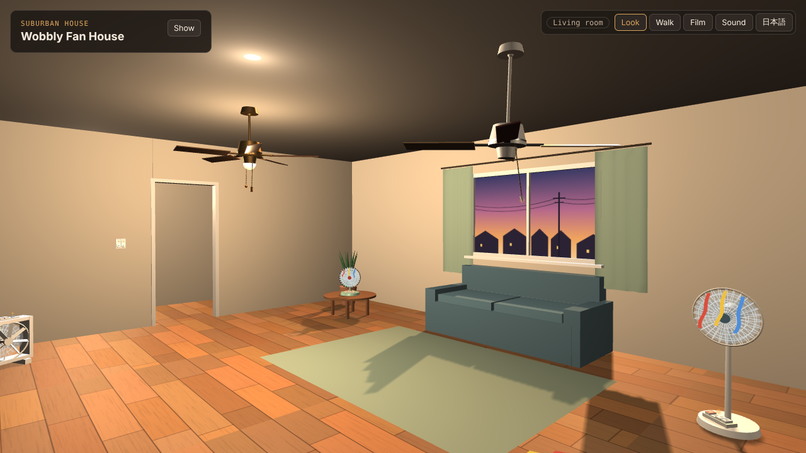
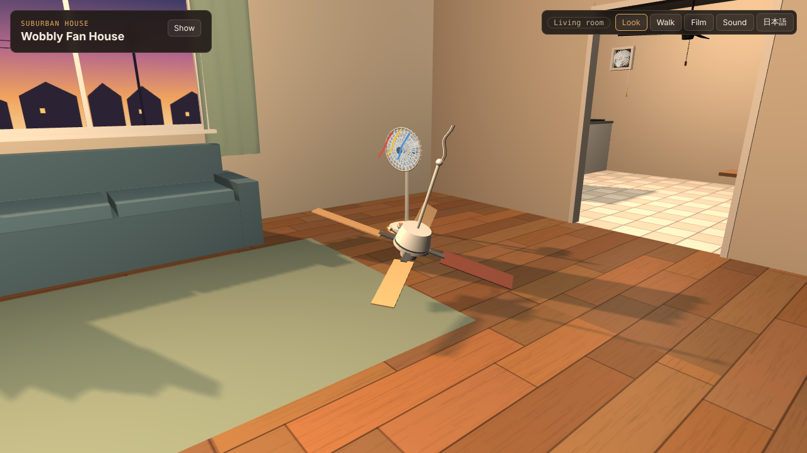
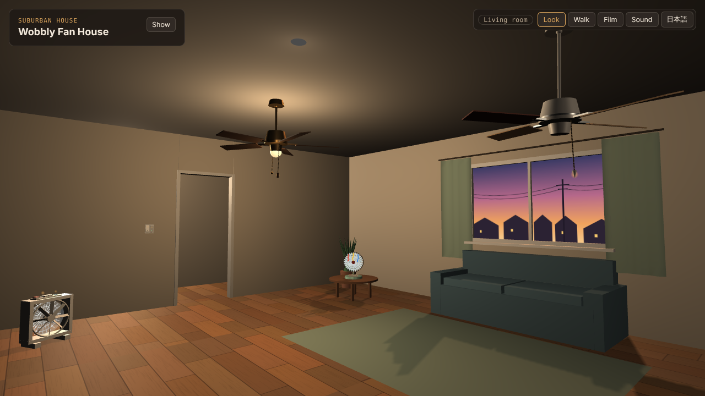
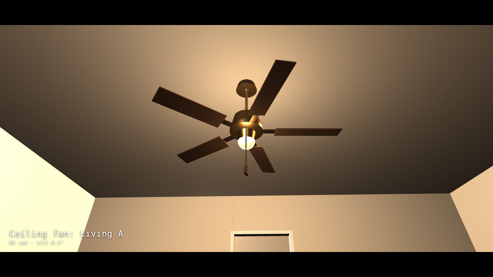
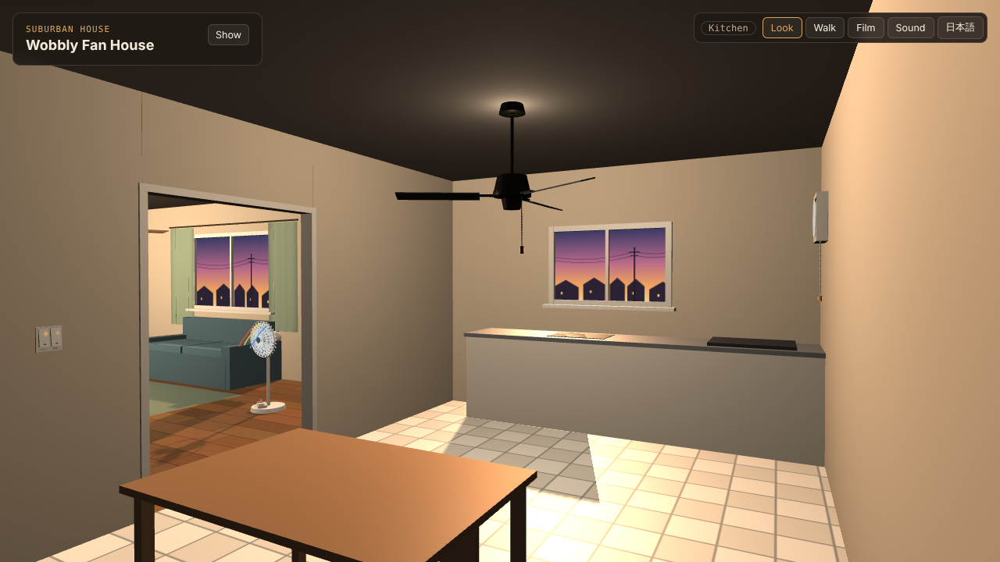
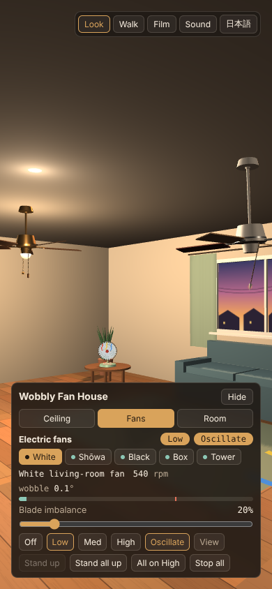

<h1 align="center">Wobbly Fan House</h1>

<p align="center"><b>English</b> | <a href="README.ja.md">日本語</a></p>

<p align="center">
  <b>A house full of ceiling fans and electric fans that wobble, tip over and fall off the ceiling.<br>
  Pull the chains, flip the switches, and push the imbalance until something gives.</b>
</p>

<p align="center">
  <a href="https://futurecortexlabs.github.io/FCTX_Wobbly_Fan_House/"><b>▶ Open the live demo</b></a>
  &nbsp;·&nbsp;
  <a href="#the-physics">The physics</a>
  &nbsp;·&nbsp;
  <a href="#known-limits">Known limits</a>
</p>

<p align="center">
  
</p>

<p align="center">
  <sub>
  The black fan has a bent blade. Raising its imbalance pushes the wobble past the tip line; the rocking builds, the fan passes its critical angle and falls. Where it lands is not scripted: the fall direction is cast against the furniture, walls and other fans, and here it hits the door frame and leans on it. Recorded in a headless browser.
  </sub>
</p>

---

## What it is

A small 3D house that runs in the browser, built around the kind of Roblox videos where someone walks through a house looking at strange, wobbling ceiling fans. Everything here (the house, the fans, the textures and the sound) is generated in code. No Roblox assets are used, and the project is not affiliated with Roblox.

It is **one HTML file**. Three.js is loaded from a CDN; there is no build step.

| What you do | What happens |
|:--|:--|
| **Pull a ceiling fan's chain** | The speed steps High → Med → Low → Off, in the same order as a real pull chain. The chain swings when you pull it, and when the fan body shakes |
| **Flip a wall switch** | Each room has a two-gang rocker: one side for the fan, one for the light. The small green locator lamp lights up when it is off, like on a Japanese wide switch |
| **Raise the blade imbalance** | The fan starts to wobble. It wobbles most near its own resonant speed, not at its top speed |
| **Push it too far** | A ceiling fan tears off its mount and drops to the floor with its wires hanging. An electric fan rocks harder and harder until it tips over, and its tip-over switch cuts the motor |
| **Turn the lights off** | The room goes dark except for the dusk outside the window, any fan light kits, and the switch lamps |
| **Walk, or film** | Walk from room to room, or let the camera visit every fan in turn with captions, for recording |

The interface switches between **English and Japanese** with the button at the top right. The labels printed on the fans' own keys stay in Japanese (切 Off, 弱 Low, 中 Med, 強 High) because they are part of the appliance.

<table>
<tr>
<td width="50%"></td>
<td width="50%"></td>
</tr>
<tr>
<td></td>
<td></td>
</tr>
<tr>
<td></td>
<td align="center"></td>
</tr>
</table>

---

## Try it

- **Online:** [futurecortexlabs.github.io/FCTX_Wobbly_Fan_House](https://futurecortexlabs.github.io/FCTX_Wobbly_Fan_House/)
- **Offline:** clone the repository and open `index.html` in a browser. It needs an internet connection the first time, to load Three.js from jsDelivr.
- **Language:** add `?lang=en` or `?lang=ja` to the URL, or use the button at the top right. The choice is remembered in the browser.

Any current browser with WebGL works (Chrome, Edge, Safari, Firefox), on desktop or phone.

| Mode | Desktop | Phone |
|:--|:--|:--|
| **Look** | Drag to orbit, scroll to zoom | Drag to orbit, pinch to zoom |
| **Walk** | WASD or arrow keys, Shift to run, drag to turn | Stick at bottom left, drag to turn |
| **Film** | Click or press Esc to exit | Tap to exit |

Everything that can be operated has a glowing dot. **Markers** in the Room panel turns the dots off.

---

## What is in the house

| Room | Ceiling fan | Other fans |
|:--|:--|:--|
| **Living room** | **Living A**: brass, 5 blades, light kit<br>**Living B**: white, 4 blades, one heavier replacement blade in a different colour | **White** pedestal fan · **Shōwa** desk fan on a low round table · **Black** fan with a bent blade · **Box** fan with a rotating louver |
| **Kitchen** | 3-blade metal fan | Wall exhaust fan with a pull cord (High → Low → Off) |
| **Hallway** | Flush-mount 4-blade fan | |
| **Bedroom** | 5-blade fan with light kit | **Tower** fan |

The three round electric fans carry paper ribbons on their guards. The ribbons hang when the fan is off and stream forward when it runs. The curtains and pull chains also move when a fan blows on them.

---

## How it works

There is no physics engine. Each behaviour is a small model of its own, updated every frame:

```
every frame (requestAnimationFrame, time step capped at 50 ms)
  |
  +- ceiling fans    spin up/down (first-order lag) -> forced response to the blade imbalance -> drop check
  +- electric fans   spin -> oscillation gear -> wobble -> rocking -> tip-over and landing -> wind direction
  +- pull chains     damped pendulum driven by the fan body's acceleration and by the wind
  +- curtains        vertices displaced by the wind field
  +- ribbons         strips bent from hanging to streaming by fan speed
  +- sound           one synthesized voice per fan, positioned in 3D; the listener is the camera
  +- render          Three.js r128: one sun through the windows, one point light per room
```

The meshes are built from primitives (cylinders, boxes, spheres, tori) plus a few hand-drawn shapes: the electric fan blades are Bézier outlines, and the wire guards are line segments. The floorboards, the dusk view, the key labels and the switch plates are drawn on a canvas and used as textures.

---

## The physics

### Wobble: forced response to a rotating imbalance

A heavy blade is a rotating imbalance, so the fan body is driven once per revolution. The tilt follows the textbook steady-state response of a damped single-degree-of-freedom system:

```
r = ω / ωn                       speed ratio to the natural frequency
X = r² / √((1 − r²)² + (2ζr)²)   amplitude ratio
φ = atan2(2ζr, 1 − r²)           the wobble lags the heavy blade by this angle
tilt = imbalance × k × X
```

The heavy blade leads and the body follows by φ. Below resonance they move almost together; above it the body swings the other way.

Because each fan has its own natural frequency ωn, the most dangerous speed is not always the top one. These are the values the house uses, at the default imbalance:

| Ceiling fan | Low / Med / High (rpm) | Natural (rpm) | ζ | Default imbalance | Tilt Low / Med / High | Imbalance that drops it |
|:--|--:|--:|--:|--:|--:|--:|
| Living A | 48 / 84 / 132 | 114 | 0.15 | 5% | 0.02° / 0.09° / 0.22° | 125% |
| **Living B** | 48 / **84** / 132 | **87** | 0.11 | 60% | 0.41° / **4.01°** / 1.64° | **83%** |
| Kitchen | 54 / 90 / 138 | 96 | 0.12 | 20% | 0.15° / 1.10° / 0.59° | 100% |
| Hallway | 72 / 114 / 168 | 120 | 0.12 | 15% | 0.13° / 0.87° / 0.46° | 95% |
| Bedroom | 48 / 84 / 132 | 138 | 0.12 | 10% | 0.02° / 0.09° / 0.60° | 92% |

Living B's medium speed sits 3 rpm below its natural frequency, so it wobbles about two and a half times harder on Med than on High.

### Ceiling fan drop

If the tilt stays above **5.5° for 2 seconds**, the fan detaches. It falls under gravity (9.8 m/s²), bounces once at 15% of its impact speed, and comes to rest tilted 16–26° onto one blade tip. The rest height is worked out from that tilt, so the blade tip touches the floor rather than sinking into it. **Re-hang** puts it back and caps the imbalance at its default.

### Electric fans: from wobble to tip-over

An electric fan stands on a base, so the question is when it stops rocking and falls. The wobble W uses the same forced-response formula, with ζ = 0.12. Below the **tip line (3.0°)** the fan only rocks a little. If W stays above the tip line, the rocking amplitude grows over about 1.3 s until it passes the critical angle

```
θc = atan(b / h)        b: distance from the centre to the base edge, h: height of the centre of mass
```

From there gravity takes over, using the rocking-block equation of motion (Housner, 1963):

```
θ'' = (3g / 4R) · sin(θ − θc)        R = √(b² + h²)
```

It bounces a few times, keeping 28% of its angular velocity at each bounce.

| Electric fan | Low / Med / High (rpm) | Natural (rpm) | Imbalance needed to cross the tip line | Critical angle θc |
|:--|--:|--:|--:|--:|
| White | 540 / 750 / 960 | 780 | 79% | 23.8° |
| Shōwa (on the table) | 600 / 840 / 1080 | 900 | 90% | 44.2° |
| Black | 510 / 720 / 930 | 840 | 86% | 20.8° |
| Box | 420 / 600 / 780 | 540 | 87% | 33.7° sideways, 22.2° forward |
| Tower | 780 / 1020 / 1260 | 960 | 76% | 21.8° |

The low, wide Shōwa fan needs more than twice the tilt of the tall black one before it goes over.

### Where a fan lands

When a fan starts to fall, a ray is cast from the tipping edge in the fall direction against the furniture boxes, the wall segments and the other fans. If something is in reach, the fan stops there: it leans on the top edge of anything lower than itself, or against the side of a wall. Otherwise it lies on the floor, resting on its guard and the edge of its base.

### Chains, wind and sound

- **Pull chains** are damped pendulums (effective length 0.65 × chain length, three sub-steps per frame). They are driven by the acceleration of the fan body they hang from, so a wobbling fan swings its own chain, and by the local wind.
- **Wind** from each electric fan is a cone. Strength scales with (speed / top speed)², falls off with the angle from the fan's axis, decays as e^(−d / 4 m) with distance, and decays as e^(−|Δy| / 1.2 m) with height difference.
- **Sound** is synthesized with Web Audio. Each fan has looping brown noise through a low-pass filter whose cutoff rises with speed, plus a faint 120 Hz motor hum: twice the 60 Hz mains frequency of central and western Japan. Every voice goes through its own HRTF panner, so a fan in the next room sounds quieter and comes from the right direction. Clicks, clacks and crashes are short bursts of band-passed noise.

---

## Verification

The page was checked in headless Chromium (Playwright, SwiftShader WebGL):

- It loads with no console errors, in English and in Japanese, at desktop size and at 390 × 844 phone size.
- Every panel control was clicked in both languages. Switching language mid-film updates the caption.
- In scripted runs, Living B drops at high imbalance and re-hangs. All five electric fans tip over and stand back up. Walk mode, film mode and room switching work.
- The numbers in the tables above were computed from the same formulas and parameters the page uses.

The screenshots and the GIF in this README come from those runs. The check scripts are not part of this repository yet, and there is no automated test suite.

---

## Performance

| | |
|:--|:--|
| Size | About 93 KB, in one HTML file |
| Network | Three.js r128 and OrbitControls from jsDelivr, plus two Google Fonts. Without the fonts it falls back to system fonts |
| Phones | Pixel ratio capped at 1.5 (2 on desktop), a 512 px shadow map instead of 1024, and a cheaper shadow filter. Pull chains and buttons get larger touch targets |
| Frame rate | Not measured on real hardware yet |

---

## Known limits

Stated plainly, so that nothing here is mistaken for a full simulation.

- **There is no rigid-body physics.** Every effect is its own model. Fans do not collide with each other or with you, apart from the landing check described above.
- **The rocking build-up is scripted.** The wobble and the fall follow the formulas above, but the growth from "over the tip line" to "past the critical angle" is a ramp over about 1.3 s, not something derived.
- **A falling ceiling fan ignores what its blades would hit.** It lands on the floor, or on top of the low furniture directly under its centre.
- **The amplitudes are tuned to be visible.** A few degrees of tilt on a ceiling fan is far more than a real one would survive, and the drop threshold is a game rule, not a structural calculation.
- **Only the sun casts shadows.** The room lights and lamp kits light the scene but cast no shadows, to keep it fast.
- **The darkness follows the camera's room.** With the lights off, the ambient light dims for the room you are in, so a lit neighbouring room seen through a doorway also looks dimmer than it should.
- **The camera is kept inside the current room's box** in Look mode. In tight spots it can still clip through furniture.

---

## Repository

| Path | Contents |
|:--|:--|
| [`index.html`](index.html) | The whole app: house, fans, models, sound, interface and both languages |
| [`docs/media/`](docs/media) | The screenshots and GIF used in this README |
| [`README.ja.md`](README.ja.md) | This README in Japanese |

---

## Licence

[Apache License 2.0](LICENSE)

Three.js (MIT licence) is loaded at runtime from jsDelivr and is not redistributed in this repository.
